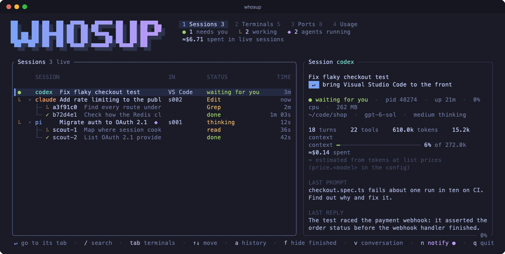
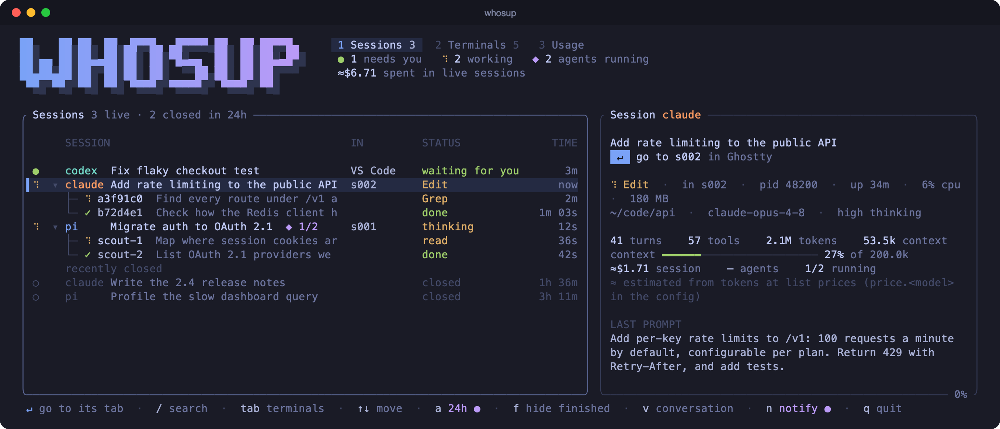
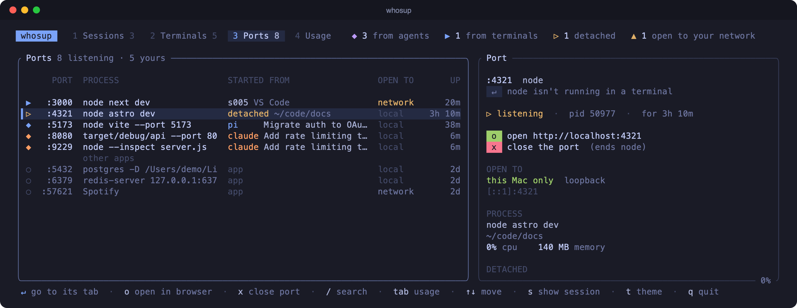
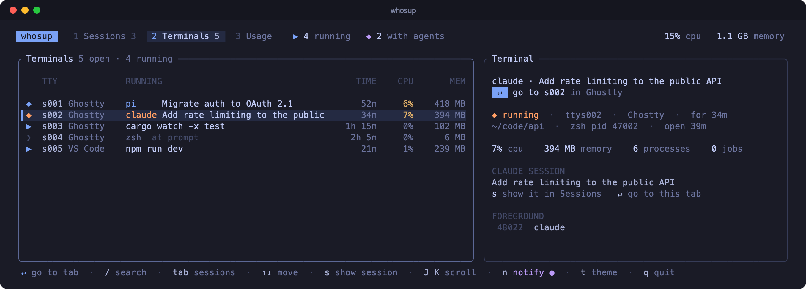

<div align="center">

[](https://github.com/kav-sw19/whosup/actions/workflows/ci.yml)

```
██    ██ ██  ██  ████   █████ ██  ██ █████
██    ██ ██  ██ ██  ██ ██     ██  ██ ██  ██
██    ██ ██  ██ ██  ██ ██     ██  ██ ██  ██
██ ██ ██ ██████ ██  ██  ████  ██  ██ █████
██ ██ ██ ██  ██ ██  ██     ██ ██  ██ ██
████████ ██  ██ ██  ██     ██ ██  ██ ██
 ██  ██  ██  ██  ████  █████   ████  ██
```

**`top` for your coding agents.**

See every pi, Claude Code, Codex, opencode, Gemini CLI and aider session you have running, what
each one is doing right now and the sub-agents working inside it, plus every open terminal and every
port your dev servers hold open. Press `↵` to jump straight to its tab.

</div>



<details>
<summary>Still screenshots (Sessions and Ports tabs)</summary>





</details>

## Why

Coding agents run for minutes at a time, start sub-agents of their own, and end up spread across
terminal tabs. whosup answers the questions you'd otherwise answer by clicking through every tab:

- **Which sessions are working, and which are waiting for me?**
- **What is each one doing right now?** Thinking, or running `bash`, `Edit`, `Grep`, …
- **Which sub-agents are running inside it**, and what did the finished ones report?
- **What is every open terminal running**, and which one holds that session?
- **Which ports are open, and who opened them?** That dev server an agent started an hour ago,
  still holding `:3000`.

It only reads the files the agents already write and the system's process list. It never talks to
an agent, sends anything over the network, or changes a file. The only things it ever stops are the
sessions and ports you ask it to, after asking you to confirm.

## Features

- **Every agent in one list, wherever it runs.** pi, Claude Code, Codex, opencode, Gemini CLI and
  aider sessions are read from their own records, whether they run in a terminal app, in an editor's
  integrated terminal (VS Code, Cursor, Zed, JetBrains, Atom, …) or inside an editor extension
  (Claude Code for VS Code, Codex). Other agent CLIs (amp, goose, crush, qwen, cursor-agent,
  copilot, droid) are found by their process. See [Supported agents](#supported-agents).
- **Live status.** Each session shows *thinking*, the tool it's running, *waiting for you*,
  *interrupted* or *error*, updated every second.
- **Sub-agents nested under their session:** Claude Code Task-tool agents, Codex multi-agent
  agents, pi `agent_run` agents and pi-subagents background runs, each with its task, model, status, duration and result.
- **Resume closed sessions.** `↵` on a closed session runs the right resume command for its agent
  (`pi --session …`, `claude --resume …`, `codex resume …`) in a new tab of the app it last ran
  in, or your default terminal.
- **See what needs you.** Sessions waiting for your reply, asking to approve a tool call, stopped
  by an error or looking stuck go to the top, in bold, with a count in the header. Turn on
  **notifications** with `n` to hear when one turns. See [Needs you and notifications](#needs-you-and-notifications).
- **Jump straight to it.** Press `↵` on a session, terminal or port and its tab comes to the front, in
  Ghostty, iTerm2, Terminal or tmux; for sessions in an editor, the editor comes to the front. The
  **IN** column shows where each one lives, and the details pane says what `↵` will do.
- **Light and dark themes.** Press `t` to switch; whosup remembers your choice.
- **A Terminals tab** listing every open terminal: its tty, the app that owns it (Ghostty, iTerm2,
  Terminal, tmux, ssh, …), the foreground command, background jobs, folder, CPU and memory.
  `s` on a terminal shows the agent session inside it.
- **A Ports tab** listing every port your processes are listening on, the process holding it, and
  where it came from: the agent session that started it, the terminal it runs in, or *detached* (a
  dev server still running after whatever started it closed). It marks ports other machines on your
  network can reach. `o` opens one in the browser and `x` closes it.
- **Files changed**, per session, from its edit tool calls, with a warning when two live sessions
  have edited the same file in the last hour.
- **A details pane** with the last prompt and reply (lightly formatted Markdown), turns, tool calls,
  tokens, context size and cost (recorded by pi, opencode and aider; estimated for the others,
  shown with `≈`).
- **Fast on large histories.** Transcripts are read incrementally, so multi-megabyte sessions cost
  almost nothing after the first read.
- **Read the whole conversation** with `v`, copy bits of it with `y`, or export it to Markdown with `e`.
- **Start a new session** with `N` in the selected session's folder.
- **Scriptable.** `whosup --once` prints a plain-text snapshot (sessions, terminals and ports)
  instead of opening the UI.

### The Usage tab

Spend and tokens for today, the last 7 days and the whole range (30 days by default; `a` switches
between 7, 30 and 90), with a daily chart and breakdowns by agent, model and project. pi's recorded cost is used as is; Claude
Code and Codex replies are priced as they happen (shown with `≈`); opencode, Gemini CLI and aider
sessions count on the day of their last activity.

### The Terminals tab



### The Ports tab

(Screenshot in the fold-out at the top.) `↵` goes to the terminal the server runs in, `s` shows the agent session that started it, `o` opens
`http://localhost:<port>`, and `x` closes the port: `k` ends the process holding it (SIGTERM) and
`9` force-kills it. Ports started from your terminals and agents, or running in one of your folders,
come first; ports held by apps (Spotify, Postgres.app, …) are listed under *other apps*. Only your
own processes are shown.

## Install

**Homebrew:**

```sh
brew install kav-sw19/tap/whosup
```

**Prebuilt binary:** download `whosup-<version>-macos-universal.tar.gz` from
[Releases](https://github.com/kav-sw19/whosup/releases) (Apple Silicon and Intel), unpack it and put
`whosup` on your PATH. The binary isn't signed with an Apple Developer ID, so macOS blocks a copy
downloaded in a browser; clear the download flag once before running it:

```sh
xattr -d com.apple.quarantine whosup
```

**From source** (Rust 1.85 or newer):

```sh
cargo install --git https://github.com/kav-sw19/whosup
```

Or from a clone:

```sh
git clone https://github.com/kav-sw19/whosup && cd whosup
cargo install --path .
```

## Usage

```sh
whosup                      # live view, refreshes every second
whosup --once               # print live sessions, open terminals and listening ports, then exit
whosup --demo               # try it with made-up sessions, terminals and ports
whosup --once --all         # also include sessions closed in the last 24 hours
whosup --recent 72          # with `a`, show sessions closed in the last 72 hours
whosup --dir ~/my-pi-dir    # use a different pi data folder
whosup --focus ttys003      # bring that tty's tab to the front, then exit
whosup --resume "auth"      # resume the closed session whose title matches "auth"
whosup --interrupt ttys003  # press Esc in that tty's tab
```

### Keys

| Key | Action |
| --- | --- |
| `/` | Search: every word must match. Sessions: the title, folder, agent, model, first prompt or a sub-agent's task. Terminals and Ports: the command, folder, tty, port or session (`↵` keeps it, `esc` clears it) |
| `tab` · `1` · `2` · `3` · `4` | Switch between Sessions, Terminals, Ports and Usage |
| `↑` `↓` · `j` `k` | Move the selection (`PgUp` / `PgDn`, `g` / `G` jump) |
| `←` `→` · `h` `l` | Collapse or expand a session's sub-agents (closed sessions start collapsed) |
| `↵` | Live session, terminal or port: bring its tab to the front. Closed session: resume it |
| `s` | On a terminal: show the agent session running in it. On a port: show the session that started it |
| `o` | On a port: open `http://localhost:<port>` in the browser |
| `J` `K` | Scroll the details pane |
| `v` | Read the whole conversation of the selected session or sub-agent (`v` / `esc` closes) |
| `y` then `r` `i` `f` `d` `l` | Copy the resume command, session id, transcript path, folder or last reply |
| `e` | Export the conversation to Markdown in `~/Downloads` |
| `x` | Stop a live session: then `i` interrupts its turn (presses Esc in its Ghostty or iTerm2 tab) or `k` ends it (SIGTERM) |
| `x` (Ports) | Close the selected port: then `k` ends the process holding it (SIGTERM) or `9` force-kills it |
| `N` | Start a new session in the selected session's folder: `1` pi, `2` claude, `3` codex, `4` opencode, `5` gemini, `6` aider (those on your PATH) |
| `a` | History: live only → recent (24h, `recent_hours=`) → 7 days → all history. On the Usage tab: 7, 30 or 90 days |
| `f` | Hide finished sub-agents |
| `p` | Group sessions by project (their git repository, else their folder) |
| `n` | Turn notifications on or off (remembered) |
| `t` | Switch between the dark and light theme (remembered) |
| `r` | Refresh now |
| `q` · `Esc` | Quit (`Esc` clears a search first) |

### Reading the status column

| Status | Meaning |
| --- | --- |
| spinner + **thinking** | Your message or a tool result was sent; the model hasn't replied yet |
| spinner + **bash**, **Edit**, … | The model is waiting for that tool to finish |
| ◆ **approve Bash?** | The agent is waiting for you to approve a tool call |
| ▲ **stuck? bash 14m**, **looping? Read ×4** | One step has run with nothing written for a while, or the same call keeps repeating |
| **new** | The agent has started but nothing has been sent yet |
| **waiting for you** | The agent finished its reply and is at the prompt |
| **interrupted** | The last reply was cut off (for example, you pressed Esc) |
| **error** | The last reply ended in an error |
| **closed** | The session's process has exited (shown with `a`) |

Sub-agents show ✓ **done**, ✗ **error**, or ◌ **orphaned** when the session that started them is gone.

## Supported agents

| Agent | Detected by | What you see | Data read |
| --- | --- | --- | --- |
| **pi** | process + transcript | Everything, including cost and sub-agents | `~/.pi/agent/sessions/` (`$PI_CODING_AGENT_DIR`) |
| **Claude Code** | process + transcript | Title, model, status, tokens, prompt and reply, Task-tool sub-agents | `~/.claude/projects/` (`$CLAUDE_CONFIG_DIR`) |
| **Codex** | process or desktop app + transcript | Thread name, model, status, tokens, prompt and reply, multi-agent sub-agents (`spawn_agent` calls and child threads naming their parent; not yet checked against a real multi-agent run) | `~/.codex/sessions/` (`$CODEX_HOME`) |
| **opencode** | process + its SQLite database | Title, model, status (thinking, the tool running, waiting for you, error), cost, tokens, prompt and reply, sub-agents (child sessions), conversation, resume (`opencode -s`) | `~/.local/share/opencode/opencode.db` (`$XDG_DATA_HOME`), read-only via `sqlite3` |
| **Gemini CLI** | process + its session files | Title, model, status (incl. waiting for approval), tokens, prompt and reply, conversation, resume (`gemini --resume`) | `~/.gemini/tmp/<project hash>/chats/` (`$GEMINI_CLI_HOME`); the folder is found by hashing folders whosup knows |
| **aider** | process + `.aider.chat.history.md` | Each `# aider chat started at` block as a session: prompt and reply, model, tokens, cost, files edited, conversation, resume (`aider --restore-chat-history`) | the history file in the project; folders where aider ran are remembered in `~/.config/whosup/aider-folders.json` |
| amp, goose, crush, qwen, cursor-agent, copilot, droid | process only | Folder, uptime, CPU, memory, terminal | — |

pi records its own cost. For Claude Code and Codex, whosup estimates cost from their token counts
(input, output, cache reads and writes) at list prices, shown with `≈`. Set your own rates with
`price.<model>=…` in the config; on a subscription plan the estimate is what the tokens would cost
through the API, not what you pay.

## Resuming a closed session

`↵` on a closed session resumes it. The details pane shows exactly what will run, and where.

| Agent | Command |
| --- | --- |
| opencode | `opencode -s <session id>` |
| Gemini CLI | `gemini --resume <session id>` |
| aider | `aider --restore-chat-history` |
| pi | `pi --session <transcript>` |
| Claude Code | `claude --resume <session id>` |
| Codex | `codex resume <thread id>` (Codex CLI); desktop-app threads open the Codex app |

It runs in the session's own folder, opened in the first of:

1. **Where it last ran**: whosup remembers the app each session runs in while it watches
   (`~/.config/whosup/hosts.json`).
2. **Where it was started**, from the transcript (Claude Code's VS Code extension, the Codex app).
3. **Your default terminal**: the terminal whosup is running in (Ghostty, iTerm2 or tmux),
   otherwise Terminal.

In Ghostty, iTerm2, Terminal and tmux it opens a new tab and types the command into your shell, so
quitting the agent leaves you in that folder. Editors can't be told to run a command in their
terminal, so whosup opens the folder in the editor and copies the command for you to paste.

## Needs you and notifications

A live session **needs you** when it has finished its turn, stopped with an error, or is waiting
for you to **approve a tool call** (shown as `approve Bash?`).

Claude Code and Codex don't record approval prompts in their transcripts, so whosup infers them:
the session's last entry is a tool request, nothing has been written for a few seconds, no
command has started for it, and the agent is idle. (Codex approval events are used directly when
present.)

It also flags sessions that look **stuck**: one step (a tool or the model thinking) running with
nothing written for 10 minutes (`stuck_minutes=` in the config), shown as `stuck? bash 14m`; or
the same tool call with the same arguments made three or more times in a row, shown as
`looping? Read ×4`. These sessions sort to the top of the list, their status is bold,
and the header counts them.

With notifications on (`n`), whosup sends a macOS notification when a session goes from working
to waiting for you, waiting for approval, an error, or looking stuck. They appear under Script Editor, the app macOS uses for
`osascript` notifications, so allow notifications for it in System Settings if none show up.
Settings live in `~/.config/whosup/config`.

### Without the window

`whosup --watch` sends the same notifications with no UI (and keeps remembering where sessions ran,
for resume). To have it run at login:

```sh
whosup --install-service     # a launchd agent running whosup --watch; log in ~/Library/Logs/whosup-watch.log
whosup --uninstall-service
```

While a watcher runs, the TUI leaves notifying to it, so you never get two of each.

## Configuration

`~/.config/whosup/config` (or `$XDG_CONFIG_HOME/whosup/config`), one `key=value` per line:

```ini
theme=dark            # or light; also set with t
notify=on             # also set with n
refresh=1000          # milliseconds between refreshes (at least 250)
hide=aider,opencode   # agents to leave out
terminal=iTerm        # where to resume and start sessions (Ghostty, Terminal, iTerm, tmux)
recent_hours=48       # how far back recent sessions go (--recent overrides it)
stuck_minutes=10      # one step running this long counts as stuck
price.opus=15,75,1.5,18.75   # USD per million tokens: input, output, cache read, cache write
```

When whosup saves `theme` or `notify`, it changes only those two lines.

## Sessions in editors

whosup finds agents by their process, so it sees them wherever they run:

- **An editor's integrated terminal.** The agent runs on a terminal like any other; whosup names the
  editor by walking the process's parents up to its app (`Visual Studio Code`, `Cursor`, `Zed`, …).
- **An editor extension.** Claude Code for VS Code starts a `claude` process per chat, which is
  matched to its transcript as usual. The Codex extension runs one `codex app-server` for all its
  threads, so its threads count as live while it runs and they were written to recently.

## How it works

1. **Find agent processes.** whosup scans the process list and recognises agent CLIs by their command
   name, including ones launched through `node` or `bun`.
2. **Read transcripts.** It reads the JSONL transcripts each agent writes, and each format is mapped
   onto one common summary: title, model, turns, tool calls, tokens and the last thing that happened.
   Files are read incrementally from where the last read stopped.
3. **Match processes to sessions.** A running process is matched to a transcript from the same agent
   in the same folder, first by start time, then by the most recently written file. This also covers
   resumed sessions.
4. **Find terminals.** `ps` gives every tty and its foreground process group; walking each tty's
   parent processes finds the app that owns it.
5. **Find ports.** `lsof` lists the TCP ports your processes listen on; walking each process's
   parents finds the agent session or terminal that started it.

Codex desktop-app threads have no process of their own, so they count as live while Codex.app (or
the Codex editor extension) is running and either some process holds the thread's transcript open,
or it was written to in the last 10 minutes (if working) or 30 minutes (if idle).

## Jumping to a tab

`↵` finds the terminal tab a session (or a port's server) runs in and brings it to the front:

| Terminal | How |
| --- | --- |
| **Ghostty** | Its AppleScript doesn't expose ttys, so whosup briefly reports a unique working directory on the session's tty (OSC 7), asks Ghostty which terminal has it, restores the real directory, and focuses that terminal. |
| **iTerm2**, **Terminal** | Selected directly by tty through AppleScript. |
| **tmux** | Selects the pane and its window, then brings up the terminal its client is attached to. |
| **Editors** (VS Code, Cursor, Zed, JetBrains, Atom, …) | Editors don't let other apps pick one of their terminal panels, so the editor's window comes to the front. Agents running in an editor extension (no terminal) do the same. |
| **Codex desktop app** | Codex.app comes to the front. |

The first time whosup controls an app other than the one it runs in, macOS asks for Automation
permission.

## Platform support

whosup runs on **macOS** (Apple Silicon and Intel).

## Limitations

- CPU is measured between refreshes, so it reads 0% in `--once` and for the live view's first second.
- When several sessions of the same agent are resumed in the same folder, the process-to-session
  match can pick the wrong one.
- Gemini CLI and aider support is checked against sample files only, and Codex multi-agent support
  hasn't been checked against a real multi-agent run yet. Bug reports are welcome.
- Process-only agents (amp, goose, crush, qwen, cursor-agent, copilot, droid) show no prompt, reply
  or status.
- tmux panes show `tmux` as their app rather than the terminal window they're displayed in.
- The Ports tab shows TCP ports only, and only your own processes. A server whose agent or terminal
  has already closed can't be traced back to it, so it shows as *detached*.
- Jumping to tabs in other terminal apps (WezTerm, kitty, Alacritty, Warp, VS Code) isn't supported yet.
- Text you've typed into an agent but not sent isn't visible, so that session still shows
  *waiting for you*.

## Screenshots

The README images are the real UI rendered from `--demo` data, cell by cell:

```sh
cargo test --release screenshots -- --ignored      # writes docs/*.svg
swiftc -O docs/svg2png.swift -o /tmp/svg2png
for f in docs/*.svg; do /tmp/svg2png "$f" "${f%.svg}.png" 2; done && rm docs/*.svg

# the demo GIF: a scripted run of the demo, rendered frame by frame
cargo test --release demo_gif -- --ignored         # writes target/gif/*.svg
for f in target/gif/*.svg; do /tmp/svg2png "$f" "${f%.svg}.png" 1; done
magick -delay 10 -loop 0 target/gif/*.png -layers Optimize docs/whosup-demo.gif
```

## Releasing

Bump `version` in `Cargo.toml`, commit, then push a matching tag:

```sh
git tag v0.4.0 && git push origin v0.4.0   # the version you just set
```

The Release workflow runs the tests, builds a universal macOS binary (`scripts/package.sh`), and
publishes it with its SHA-256 and a Homebrew formula (`whosup.rb`). With a `TAP_TOKEN` repository
secret that can push to `kav-sw19/homebrew-tap`, it also updates the tap's `Formula/whosup.rb`.

## Development

```sh
cargo build --release
cargo test

# render the UI from your real data to stdout (and colour previews to /tmp/whosup-*.html);
# WHOSUP_VIEW=terminals|ports|usage picks a tab, WHOSUP_DEMO=1 uses the demo data
cargo test --release render -- --ignored --nocapture
```

| File | What it does |
| --- | --- |
| `src/main.rs` | Arguments, app state, keys and the refresh loop |
| `src/data.rs` | Session discovery, incremental transcript cache, process matching, sub-agents |
| `src/providers.rs` | Agent detection, plus the Claude Code and Codex transcript parsers |
| `src/opencode.rs` | opencode sessions, read from its SQLite database |
| `src/more_agents.rs` | Gemini CLI and aider sessions |
| `src/convo.rs` · `src/export.rs` | The conversation view (`v`), copying (`y`) and Markdown export (`e`) |
| `src/resume.rs` | Resuming closed sessions and starting new ones |
| `src/usage.rs` · `src/cost.rs` · `src/models.rs` | The Usage tab, cost estimates and model prices |
| `src/settings.rs` · `src/watch.rs` | The config file, and `--watch` notifications |
| `src/demo.rs` | The made-up data for `--demo` and the README images |
| `src/terms.rs` | Terminal discovery: ttys, foreground commands, jobs, owning app |
| `src/ports.rs` | Listening ports (`lsof`), who opened them, closing them |
| `src/focus.rs` | Bringing a tty's tab to the front (Ghostty, iTerm2, Terminal, tmux) |
| `src/ui.rs` | Rendering: palette, tabs, lists, details pane, Usage chart |

Adding an agent with a JSONL transcript means adding it to `Tool`, writing an `ingest_*` parser in
`providers.rs` and listing its transcript folder in `Scanner::transcript_files`.

## License

MIT. See [LICENSE](LICENSE).
